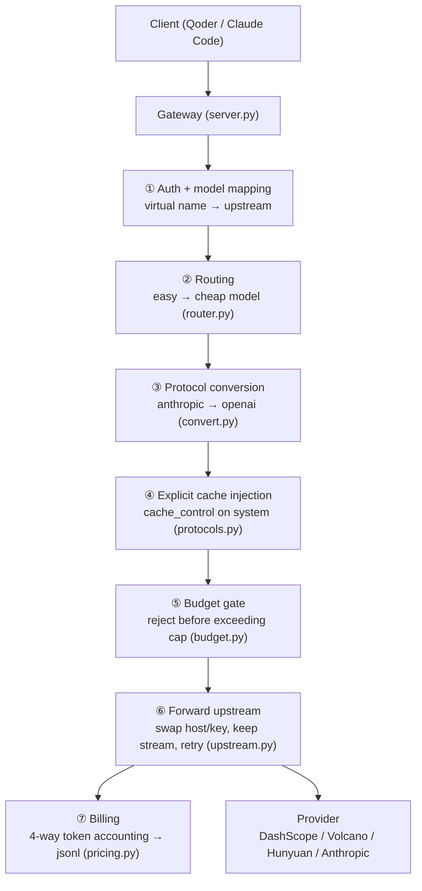

# token-gateway · Cut Your LLM API Bill, Locally

[](LICENSE)
[](https://www.python.org/)
[](#dual-protocol)

> **中文文档**: [README.md](README.md) · **面试复盘**: [WRITEUP.md](WRITEUP.md) (in Chinese)

A **local gateway** that sits between your AI coding client (Qoder / Claude Code) and your model
provider. It's not just a forwarding + billing pipe — it's a **decision layer** that cuts cost with
three levers (caching / routing / budgeting), and it logs every cent so the savings are provable,
not estimated.

> **Measured: routing cuts cost 51%, routing + cache 55% — with no statistically significant quality
> loss on our eval set (the cheap model actually scored slightly higher).**
> Numbers are read from logs, not estimated; quality claims come with a paired statistical test.
> See [Results](#results).

---

## Why

Everyone paying for LLM APIs feels the burn of token bills. Most "solutions" either reimplement the
whole protocol stack (like LiteLLM) or show you a dashboard without changing what you actually pay.

This project does one thing well: **put a thin decision layer between your client and the provider
that makes the same call cheaper** — and prove it with numbers.

---

## Results

35 questions (easy 15 / medium 10 / hard 10) × 3 turns, long system prompt (simulating Claude Code's
real multi-thousand-token context), four configs compared:

| Config | Cost | vs baseline | Subj. score | Coverage | Notes |
|---|---|---|---|---|---|
| Baseline (implicit cache) | ¥0.2497 | — | 3.31 | 99.3% | control |
| Explicit cache | ¥0.2490 | -0.3% | 3.29 | 96.4% | no effect on plus-latest |
| Model routing (implicit cache) | ¥0.1218 | **-51.2%** | 3.47 | 97.9% | lossy (undetectable) |
| Routing + explicit cache | ¥0.1124 | **-55.0%** | 3.44 | 98.6% | full stack |

**Two honest notes:**

- **Caching is lossless — but only if the upstream model supports it.** We measured that caching
  support varies by model: qwen-flash supports it (implicit + explicit), qwen-plus-latest does not
  (returns no cache fields). So the cache-only config saves just 0.3% (≈ nothing).
- **Routing saves money mostly because the cheap model is good enough**, not because the router
  classifies perfectly. The paired Wilcoxon test gives p = 0.128 (not significant), mean difference
  +0.11 in favor of the cheap model. The savings number is hard (from logs); the quality number is
  soft (LLM-judge, limited signal-to-noise) — we say so explicitly.

---

## How it works

Three levers, from lossless to lossy:

| Lever | What it does | Effect |
|---|---|---|
| **Caching** (lossless) | Tag the system prompt with `cache_control` for deterministic cache hits | per-token price ↓ |
| **Routing** (lossy) | Guess the difficulty of the last user message; easy → cheap model | ~51% off |
| **Budgeting** (cap) | Reject requests before they exceed a running total (HTTP 402) | total bill ↓ |



### 4-way billing

`pricing.py` splits each request into four charges: `input` / `output` / `cache_read` / `cache_write`.
Key detail: `prompt_tokens` already *includes* the cached and cache-creation tokens, so we first
compute `uncached = input - cache_read - cache_write` and only charge full price for the uncached
part. Get this wrong and you overcharge by up to 10×. After routing, cost is billed against the
`billed_model` (the one actually used), not the client's `virtual_model`.

### Dual protocol

OpenAI `/v1/chat/completions` and Anthropic `/v1/messages` are both supported — streaming, tool-call
mapping (`tool_use` ↔ `tool_calls`), and image blocks included. The Anthropic → OpenAI conversion is
what lets Claude Code run on a DashScope key.

---

## Quick start

**Step 1 — self-test (no API key needed).** Run `selftest.bat` (or `run.bat test`). It spins up a fake
upstream + a real gateway, runs every happy path and failure case, and checks the ledger. No real key,
no cost.

**Step 2 — set a real provider key** (e.g. Alibaba Cloud DashScope). Keys live in environment
variables, never in `config.json` (which is open-sourced):

```powershell
$k = Read-Host "paste key then Enter"
[Environment]::SetEnvironmentVariable("DASHSCOPE_API_KEY", $k.Trim(), "User")
Remove-Variable k
```

**Step 3 — start the gateway.** Double-click `run.bat` (or `python run_gateway.py`).

**Step 4 — point your client at it.**

- Qoder: provider = Custom → OpenAI Compatible, Base URL `http://127.0.0.1:8317/v1`, key `sk-gw-local-dev`.
- Claude Code: `ANTHROPIC_BASE_URL=http://127.0.0.1:8317`, `ANTHROPIC_API_KEY=sk-gw-local-dev`,
  `ANTHROPIC_MODEL=claude-sonnet-4-5`.

See the Chinese [README](README.md) for full config, troubleshooting, and the MCP / dashboard features.

---

## Project layout

```
server.py          main flow: receive → decide → convert → forward → bill
protocols.py       protocol-diff tables + cache injection + usage parsing
convert.py         anthropic → openai conversion
pricing.py         4-way billing
budget.py          budget gate
router.py          model routing (difficulty guess + same-provider guard)
upstream.py        talk to the provider
usage_log.py       append-only jsonl ledger (facts only, no content)
run_eval.py        eval runner; judge.py scoring; analyze_router.py stats
mcp_server.py      MCP shell: query cost/budget/usage from Claude Code
dashboard.py       one-shot, self-contained HTML cost dashboard
```

## License

[MIT](LICENSE)
