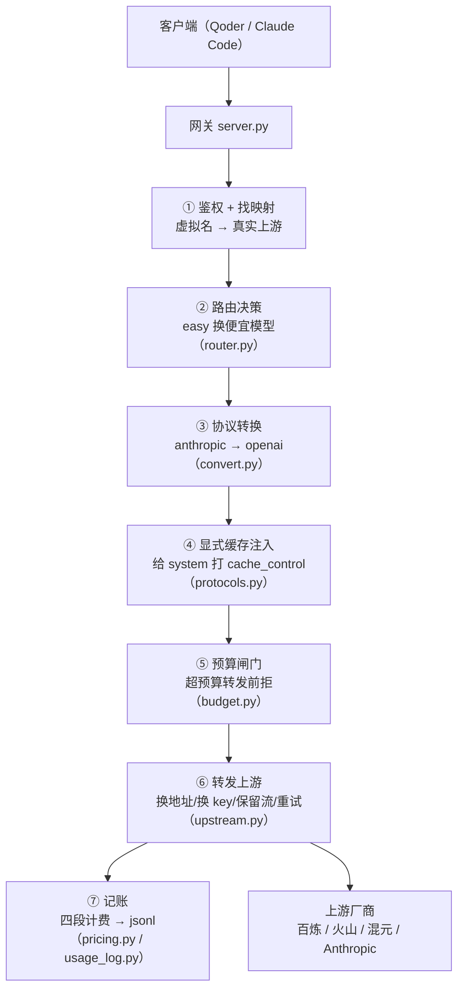

# token 网关 · 本地 LLM 省钱网关

[](LICENSE)
[](https://www.python.org/)
[](#能力清单)

> 📖 **English**: see [README.en.md](README.en.md)

一个跑在**你自己机器上**的本地网关，夹在 **AI 编程客户端**（Qoder / Claude Code）和**模型厂商**之间。
它不只是一个「转发 + 记账」的管道，而是一个**决策层**：用「缓存 + 路由 + 预算闸门」三招省钱，
并且每一分钱都记在日志里、可对账、可证明。

> **实测结论：路由省 51%、路由+缓存叠加省 55%——质量损失在当前评测集下测不显著（flash 反而略高）。**
> 数字从日志读，不是估算；质量结论附了统计检验，不是拍脑袋。见 [省多少](#省多少实测)。
> ⚠️ 显式缓存对 qwen-plus-latest 无效（该模型不支持缓存），缓存省钱只在 qwen-flash 上生效。

---

## 省多少（实测）

35 题（easy 15 / medium 10 / hard 10）× 3 轮技术问答，长 system（模拟 Claude Code 真实几千 token 上下文），跑四个配置对比：

| 配置 | 总成本 | 相对基线 | 主观分 | 要点覆盖 | 说明 |
|---|---|---|---|---|---|
| 基线（隐式缓存，纯透传） | ¥0.2497 | — | 3.31 | 99.3% | 对照 |
| 显式缓存 | ¥0.2490 | -0.3% | 3.29 | 96.4% | 对 plus-latest 无效 |
| 模型路由（隐式缓存） | ¥0.1218 | **-51.2%** | 3.47 | 97.9% | 有损（但测不出损失） |
| 路由 + 显式缓存 | ¥0.1124 | **-55.0%** | 3.44 | 98.6% | 全开 |

**两条手段的性质完全不同：**

- **缓存 = 无损省钱，但前提是上游模型支持缓存。** 模型看到的输入一个字不变，只是把计费从「全价输入」换成「缓存命中 10% 价」。实测发现百炼缓存支持因模型而异：qwen-flash 支持（隐式+显式都命中），qwen-plus-latest 不支持（两种都不返回缓存字段）——所以纯缓存配置（全走 plus-latest）只省 0.3%（等于没省）。
- **路由 = 有损省钱。** easy 题换便宜模型（qwen-plus-latest → qwen-flash，输入价约 1/5.3），质量可能掉。但实测配对检验 **p = 0.128，不显著**，纯路由题均值差 +0.11（flash 反而略高）。

**关于「质量损失测不显著」这句话，两个诚实的解读：** ① flash 在 easy 题上确实够用（真·近乎无损）；② 评测集规模仍有限（纯路由题 27 个），真实存在的小损失仍可能被噪声掩盖。**当前数据无法严格区分这两者。** 省钱数字是硬的（从日志读）；质量结论是软的（LLM-judge 主观分，信噪比有限）。统计收尾见 [评测](#评测)。

---

## 能力清单

| | |
|---|---|
| ✅ 双协议 | OpenAI `/v1/chat/completions`；Anthropic `/v1/messages` |
| ✅ 协议转换 | anthropic → openai（流式 + 非流式，**含工具调用 tool_use/tool_calls 双向映射** + **图片 image block → image_url**）；反向 openai → anthropic 未做，走错方向直接 400 说明 |
| ✅ 流式透传 | 边收边转、不缓冲、内容不改 |
| ✅ 流式用量统计 | 两种协议的用量落点不同，都已处理 |
| ✅ **四段计费** | input / output / cache_read / cache_write 分开记，按「实际用的模型」计价 |
| ✅ **显式缓存** | 主动给 system 打 `cache_control`，确定性命中（隐式缓存命中率不确定，显式是确定性的） |
| ✅ **模型路由** | easy 题自动换成便宜模型（qwen-flash），medium/hard 仍走 qwen-plus-latest |
| ✅ **预算闸门** | 按日志累计成本，超预算就在转发前拒（402），把「省钱」升级成「控钱」 |
| ✅ 失败分类与退避重试 | 只在上游还没吐第一个字节之前重试 |
| ✅ 只记统计量，不记内容 | 日志可以安全公开 |
| ✅ `GET /v1/models`、`count_tokens` | 客户端「添加模型」和 Claude Code 启动都要调 |
| ✅ 容忍「绝对形式」请求行 | 本机代理没绕过 `127.0.0.1` 时的兜底 |
| ✅ **MCP 壳** | 把「查成本 / 查预算 / 查用量」暴露成 MCP 工具，Claude Code 等客户端主动查询（`mcp_server.py`，基于 fastmcp） |
| ✅ **成本看板** | 一键生成自包含 HTML（`run.bat dashboard` → `dashboard.html`），总成本 / 按模型 / 按天趋势 / 缓存节省，双击即看、零依赖 |
| ❌ 反向协议转换 / 部署 | 未做 |

---

## 架构

请求走一条固定的流水线，每一层只干一件事：



核心设计哲学只有一条：**把会变的抽成数据（`config.json` + `protocols.py` 的表），把不变的写成逻辑。** 加一家厂商 = 在 `config.json` 加一条映射；加一种协议 = 在表里加一行，主流程零改动。

---

## 跑起来

### 第 1 步 · 自验（**不需要任何 API key**）

**最简单：双击 `selftest.bat`**（或 `run.bat test`）。它会自己起一个**假上游** + 一个**真网关**，
跑完所有正常组合和异常场景，读回日志逐项对账。第一次运行会自动建独立环境、装依赖（约 1 分钟）。

**为什么要假上游**：没有它，你得先申请真 key 才能验证任何东西。而这套代码最容易错的地方
（流式用量的落点）**跟上游是谁无关**——用假上游验一遍，接真厂商时就只剩「key 对不对」一个问题。

### 第 2 步 · 配真厂商 key（以阿里云百炼为例）

**key 不写进配置文件**（`config.json` 要开源），只写环境变量名。在 PowerShell 里跑（每个 key 一次）：

```powershell
$k = Read-Host "粘贴 key 后回车"
[Environment]::SetEnvironmentVariable("DASHSCOPE_API_KEY", $k.Trim(), "User")
Remove-Variable k
```

**必须设成「永久」变量**——网关是双击 `run.bat` 启动的另一个进程，读不到临时变量。

> 三个最容易踩的坑（都跟权限无关，但症状像权限问题）：
> ① **用主账号登录**百炼控制台（RAM 子账号下「创建 API Key」按钮是灰的）；
> ② 地域选**华北2（北京）**（`config.json` 写的北京域名，选错 401）；
> ③ 创建 key 时权限选**全部权限**，别选「自定义」（自定义要求配 IP 白名单，家用动态 IP 一变就 401）。
> key 只在创建时完整显示一次，立刻复制。

**真正的安全重点不是权限，是三件事**（按性价比排序）：
1. **打开「额度用完即停」**（百炼控制台 → 额度管理）——唯一能封住「程序死循环刷出真账单」的开关；
2. **只用学生免费额度，不充值**——最坏情况是额度被刷光，不会产生真账单；
3. **key 不进 git、不发给任何人**——本项目的 `config.json` 只写变量名，`.gitignore` 已排除 `.env`。

> **为什么不用 RAM 子账号的 key**：自 2026-03-25 起华北2（北京）新建 API Key 一律归属主账号；
> 且百炼 API Key（`sk-` 开头）只能调模型、不能操作阿里云资源，和 AccessKey（AK/SK）是两种凭证。
> **本项目永远不需要你的 AccessKey。**

换别的厂商就改中间那个变量名（`ARK_API_KEY` / `ANTHROPIC_API_KEY` / `HUNYUAN_API_KEY`），方法一样。
设完**关掉所有终端重开**，再验证（只报长度，不把 key 打上屏）：

```powershell
if ($env:DASHSCOPE_API_KEY) { "OK，长度 " + $env:DASHSCOPE_API_KEY.Length } else { "空的" }
```

### 第 3 步 · 启动网关

双击 `run.bat`（或 `python run_gateway.py`，它会从注册表直接读 key，不依赖环境变量继承）。
看到监听提示后**别关窗口**。

### 第 4 步 · 把客户端切过来

**Qoder**（最容易错的是「提供商」——必须选**自定义 → OpenAI Compatible**，不能选预置的「阿里云百炼」）：

| 字段 | 填什么 |
|---|---|
| 提供商 | 自定义 → **OpenAI Compatible** |
| Base URL | `http://127.0.0.1:8317/v1` |
| API Key | `sk-gw-local-dev`（网关自己的 key，**不是**厂商 key） |
| 模型 ID | `gw-qwen` |

> 两个隐藏坑：① 类型选 **Chat Completions API**（不选 Responses API）；② **关掉 Auto Mode**，
> 否则 Qoder 自动匹配内置模型，根本不走你配的端点。

**Claude Code**（走 Anthropic 协议，网关已做 anthropic→openai 转换，所以它能用百炼 key）：

```bash
ANTHROPIC_BASE_URL=http://127.0.0.1:8317
ANTHROPIC_API_KEY=sk-gw-local-dev
ANTHROPIC_MODEL=claude-sonnet-4-5   # 这是 config.json 里的映射名，上游实际走 qwen-plus-latest
```

**验收标准**：随便问一句话正常回答，同时 `logs/usage.jsonl` 多出一行，token 数和厂商控制台对得上。

### 第 5 步 · Docker 部署（可选）

不想装 Python 环境、或要在服务器上跑时，一条命令起网关（机器上装 Docker Desktop 即可）：

```bash
# 方式一：docker compose（推荐，key 从环境变量或 .env 读）
docker compose up -d

# 方式二：手动构建 + 运行
docker build -t llm-token-gateway .
docker run -d -p 8317:8317 -e DASHSCOPE_API_KEY=你的key --name gateway llm-token-gateway
```

起来后客户端填法和上面第 4 步一样（Base URL `http://127.0.0.1:8317/v1`）。

几个要点：

- **key 必须用 `-e` 传进容器**——容器里没有 Windows 注册表，读不到你本机的 key。用 compose 就建一个 `.env` 文件写 `DASHSCOPE_API_KEY=xxx`（已在 `.gitignore` 里，不会进 git）。
- 容器监听 `0.0.0.0:8317` 再映射到宿主机 8317；日志挂在 `./logs` 卷上，宿主机能直接看账本。
- 换厂商就多传一个变量（`ARK_API_KEY` / `ANTHROPIC_API_KEY` / `HUNYUAN_API_KEY`）。

---

## 省钱机制

### 缓存（无损）

上游对「重复的前缀」有缓存价：命中的部分按输入的 **10%（显式）/ 20%（隐式）** 计价，比全价便宜 5~10 倍。

- **隐式缓存**：厂商自动判定，但**命中率不确定**（百炼最小可缓存 1024 token，达到只是「具备条件不保证命中」）。
- **显式缓存**：网关主动给 system 消息打 `cache_control: {"type":"ephemeral"}` 标记，**确定性命中**。
  config.json 里 `cache.explicit` 控制（默认 false = 隐式）。

实测发现缓存支持**因模型而异**（qwen-plus-latest + qwen-flash 重测）：qwen-flash 支持（隐式命中 31104 token、显式命中 63504 token），qwen-plus-latest 两种都不返回缓存字段——纯缓存配置因此只省 0.3%。**「缓存省钱」的成立前提是上游模型支持缓存**，换成支持的模型（如 qwen-flash、多数 Claude/GPT）即有效。

### 路由（有损）

`router.py` 对「最后一个 user 消息」猜难度：命中难词 → hard；≤140 字 → easy；≥280 字 → hard。
判为 easy 的请求换成便宜模型（qwen-plus-latest → qwen-flash，输入价约 1/5.3）。规则故意做得笨：
**不读人工标签、不自我欺骗**，只从文本猜，让评测能量出「猜错」的真实代价。

config.json 里 `routing.enabled` 控制（默认 false = 纯透传）。**只允许同厂商降档**（跨厂商不做）。

### 四段计费

`pricing.py` 把一次请求的钱拆成四块：`input` / `output` / `cache_read` / `cache_write`。
关键细节：`prompt_tokens`（总输入）**已经包含**缓存命中和缓存创建的部分，所以计费时先
`uncached = input - cache_read - cache_write`，只对未缓存部分按全价。不拆开算，钱能差十倍。

路由换模型后，成本按 **`billed_model`（实际用的模型）** 计，不按客户端请求的 `virtual_model`——否则省了钱还记原价，等于白省。

### 预算闸门（控总量）

缓存和路由降的是**单价**（每百万 token 多少钱），但单价再低也拦不住「次数太多 / 单次输入太大」把总账推上去。预算闸门管**总量**：

- **硬上限**：窗口内累计花费（把日志里所有计费记录按当前单价重算）达到上限 → 拒绝请求（HTTP 402），一个 token 都不再放。
- **预检**（可选，默认关）：发请求前按「本次输入全价、无缓存」的最坏情况估一笔，防一次超大上下文直接冲爆预算。

`config.json` 的 `budget` 段控制：`enabled`（默认 false）、`window`（`total` 累计 / `daily` 每天零点重置）、`cap_yuan`（人民币上限）、`preflight`。

这是和厂商控制台「额度用完即停」**互补**的一层：厂商的开关兜底「厂商侧额度」，
网关的闸门按「你自己的预算」在本地拦，还能按天滚动、不依赖控制台。拦下时返回
`x-gateway-budget: exceeded` 头 + 错误类型 `gateway_budget_exceeded`，一眼能认出是预算拦截、不是上游坏了。

### MCP 壳（查账，不转发）

省钱动作发生在**网关**（夹在客户端和厂商之间强制执行）；MCP 是**插件形态的外壳**，
让 Claude Code 等客户端能主动**问**「我花了多少、预算还剩多少、钱花在哪」。
它不碰网关进程，只读 `config.json`（价格表 + 预算）和 `logs/usage.jsonl`（账本），
用 `pricing.py` 把 token 换成钱——**网关不在线也能查历史账**。

三个工具（`mcp_server.py`，基于 fastmcp）：

| 工具 | 作用 |
|---|---|
| `cost_summary` | 累计成本 + 按模型分组 + 缓存省了多少 |
| `budget_status` | 预算闸门开没开、上限、已花、剩余 |
| `recent_usage(n)` | 最近 n 条请求的时间/模型/token/成本 |

**挂到 Claude Code**（transport 是 stdio）：

```bash
# 用本项目的 venv 跑，避免依赖系统 Python 里有没有 fastmcp
claude mcp add gateway --env PYTHONIOENCODING=utf-8 -- <venv路径>/Scripts/python.exe <gateway路径>/mcp_server.py
```

或写进 `.mcp.json`：

```json
{
  "mcpServers": {
    "gateway": {
      "command": "<venv路径>/Scripts/python.exe",
      "args": ["<gateway路径>/mcp_server.py"],
      "env": { "PYTHONIOENCODING": "utf-8" }
    }
  }
}
```

> 依赖在 `gateway/.venv`（`selftest.bat` 首跑时建的），`fastmcp` 已装进这个 venv。
> 本机的 `python` 是系统版（3.14.6），未必有 fastmcp，所以命令里要**显式写 venv 的 python**。

### 成本看板（给人看的账本）

MCP 壳是给**客户端**查账的（机器读）；看板是给**人**看的（眼睛读）。
`run.bat dashboard` 跑一次，生成 `dashboard.html` —— 总成本 / 按模型分组 / 每日趋势 /
缓存节省 / 最近请求 / 预算状态，**数据全部烘焙进 HTML，双击即看、完全离线、零依赖**。

看板是**静态快照**：账本一周看一两次就够了，不值得常开一个 web 服务。想看就重跑一下，
生成的 HTML 还能当记录存档、随手转发（日志只记事实不记内容，可安全公开）。

---

## 评测

评测是「证明省钱」的闭环，不是锦上添花。

- **`run_eval.py`**：读 `evalset.json`，35 题（easy 15 / medium 10 / hard 10）× 3 轮多轮对话，成本从**网关日志**读（不自己估），质量用 `judge.py`（LLM 主观 1~5 + 客观要点覆盖）打。
  - `GW_ROUTING=1` / `GW_CACHE=1` 两个开关控制跑哪种配置，分别输出 `eval_baseline.json` / `eval_cache.json` / `eval_routing.json` / `eval_stack.json`。
- **`analyze_router.py`**：统计收尾。用「同输入两次跑」分离出**重测噪声**，再拿它当尺子量路由差，配对 Wilcoxon 检验（手写精确 p 值，不依赖 scipy）。

**方法论结论（也是这个项目里最值得讲的一段）**：省钱数字硬（日志），质量数字软（LLM-judge 主观分信噪比有限）。
单次点估计会把「重测噪声」误当成「真实质量差」——短 system 测出「掉 10.5%」、长 system 测出「涨 7%」，方向都能反。只有把噪声分离出来、做配对检验，才敢说质量结论。

---

## 常见故障

| 症状 | 真正的原因 | 怎么办 |
|---|---|---|
| 全站 404，连 `/v1/models` 也 404 | 本机代理没绕过 `127.0.0.1`，请求被包成「绝对形式」发回 | 网关已内置剥前缀；仍 404 就设 `NO_PROXY=127.0.0.1,localhost` |
| 客户端说「API Key 无效」 | 填了厂商 key 而非 `sk-gw-local-dev`；或选了预置供应商（直连厂商）；或环境变量是临时的 | 填网关 key → 提供商选自定义 → 用永久变量并重开终端 |
| 日志全是 `status: 401` | 厂商 key 粘贴夹带空格/换行，或已删 | 重新 `Read-Host` + `.Trim()` 设一遍 |
| 日志 `ok:false`、`error_kind:connect` | 连不上上游（网络/代理/域名） | 看日志 `upstream_host`，核对 `config.json` 的 `base_url` |
| 流式却无 token 数 | 上游没回传 usage | 看 `injected_stream_options` 是否 true |
| 日志 `status: 403` 且响应体含 `AllocationQuota.FreeTierOnly` | 该模型的免费额度用完了（**不是 key 问题**） | 换有额度的模型变体（如 qwen-plus → qwen-plus-latest），或关「额度用完即停」切付费 |

---

## 日志

一行一条，`logs/usage.jsonl`。关键字段：`billed_model`（成本按谁算）、`routed`、`difficulty`、
`explicit_cache`、`input/output/cache_read/cache_write`、`usage_reported`（上游给的还是自己数的）。
**没有任何字段装请求原文**，只记形状（条数、字符数、有没有图），不记内容。

---

## 设计决策

1. **协议差异做成表，不写 if 分支**——`protocols.py` 的 `ROUTES` / `PROTOCOL_AUTH` / `STREAM_USAGE` 三张表是全项目唯一知道「OpenAI 和 Anthropic 有什么不同」的地方。加第三种协议 = 加一行。
2. **「一个字不改」却为 `stream_options` 破例**——不注入 `include_usage`，流式就没用量数字，项目没一样东西能被证明。但它做成了可关开关，「能退」比「能省」重要。
3. **协议转换只做一半（anthropic→openai）**——完整双向转换是 LiteLLM 已经做好的事，不重造轮子。做单向只是为了「Claude Code 用上百炼 key」这个具体场景。反向走错方向直接 400 说明。
4. **路由是「有损优化」的铁律**——只报省钱不报质量损失 = 骗人。所以评测必须成本、质量两条线一起报，且质量要过统计检验。

---

## 文件地图

```
gateway/
  server.py          ★ 主流程：收下 → 决策 → 转换 → 转发 → 记账
  protocols.py       ★ 地基：协议差异表 + 显式缓存注入 + 用量解析
  convert.py            协议转换（anthropic→openai，流式+非流式）
  pricing.py            四段计费（按 billed_model，减缓存重复计费）
  budget.py             预算闸门（按日志累计成本，超预算转发前拒）
  router.py             模型路由（猜难度 + 同厂商降档守卫）
  upstream.py           跟上游说话：换地址换key、保留流、失败重试
  usage_log.py          记账：只记事实 + 统计量，jsonl 追加写
  config.json           映射表 + 价格 + 缓存/路由开关。只写变量名，不写 key
  run_gateway.py        常驻启动（从注册表读 key）
  run.bat               双击启动；run.bat test 跑自验
  requirements.txt      依赖清单（fastapi/uvicorn/httpx，已锁版本）
  Dockerfile            容器化构建（Linux，环境变量传 key）
  docker-compose.yml    一键启动（key 从 .env 读，日志挂卷）
  selftest.py           自验：假上游 + 真网关 + 对账（无需 key）
  e2e_long_run.py       真实百炼多轮 agent loop 长跑（anthropic→openai 转换 + 工具调用往返）
  mcp_server.py         MCP 壳：查成本/预算/用量的三个查询工具（fastmcp）
  mcp_smoke.py          MCP 壳冒烟测试：直接调用 + stdio 端到端拉起
  dashboard.py          成本看板：读日志生成自包含 dashboard.html
  dashboard.html        生成的看板（双击即看，可重跑刷新）
  run_eval.py           评测：多轮对话 + 成本 + 打分
  judge.py              打分：主观 1~5 + 客观要点覆盖
  evalset.json          评测集（35 题 × 3 轮，长 system）
  analyze_router.py     统计收尾：重测噪声 + 配对检验
  eval_*.json           四份评测结果（基线/缓存/路由/叠加）
  WRITEUP.md            项目复盘（给面试官看的完整复盘，8 章）
```

**要改代码**：PowerShell 里 `cd` 到 `gateway`，敲 `code .`（`code` 就是 Qoder IDE）。
**对话里的预览面板只能看，改不了文件。**

---

## 下一步（按价值排序）

1. **接 Claude Code 真实跑一段**：验证 anthropic→openai 转换在真实长对话 + 工具调用下的稳定性（已完成多轮 agent loop 长跑验证 `e2e_long_run.py`：真实百炼上工具调用往返 + 最终收敛正常；若想 100% 真实，可自己开 Claude Code 挂上再压一段）。
2. **反向协议转换（openai→anthropic）**：如果有「OpenAI 客户端 + Claude 上游」的场景再补。
3. **云部署 / GitHub 发布**：作为求职项目，最后补一个可公开展示的落地形态（成本看板 `dashboard.html`、复盘文 `WRITEUP.md` 已完成）。
